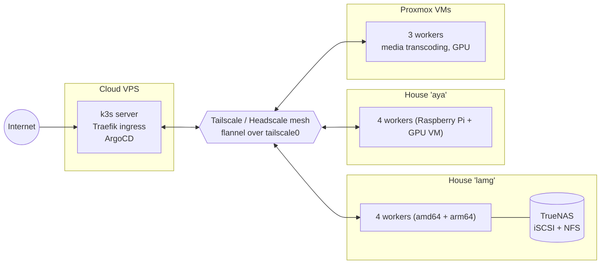

# agonbar-kubernetes

[](https://github.com/agonbar/agonbar-kubernetes/actions/workflows/ci.yaml)
[](LICENSE)

GitOps configuration for my personal [K3s](https://k3s.io/) cluster: 12 nodes
across three sites, joined by a WireGuard mesh, with the control plane on a
cloud VPS. [ArgoCD](https://argo-cd.readthedocs.io/) reconciles everything in
this repo onto the cluster. Nothing is applied by hand except the ArgoCD
bootstrap.



## Stack

| Component | Technology |
|-----------|------------|
| Distribution | K3s: one cloud server, workers on SBCs, mini PCs and Proxmox VMs |
| Mesh networking | Tailscale on every node with Headscale as control server; `flannel-iface: tailscale0`, so all pod traffic rides the overlay. NetBird for guest access |
| Ingress | [Traefik](https://traefik.io/) + [cert-manager](https://cert-manager.io/) (Let's Encrypt, HTTP-01 and DNS-01 through the OVH API) |
| LoadBalancer IPs | [kube-vip](https://kube-vip.io/) with per-house pools: a Service annotated `svccontroller.k3s.cattle.io/lbpool=aya` only gets IPs from aya nodes, never from the VPS |
| GitOps | ArgoCD app-of-apps (35 Applications, prune + self-heal) with an envsubst CMP sidecar that renders `${BASE_DOMAIN}` |
| Secrets | [Sealed Secrets](https://github.com/bitnami/sealed-secrets), cluster-wide scope; plaintext never enters git (enforced by gitleaks, see [CI](#ci)) |
| Storage | [democratic-csi](https://github.com/democratic-csi/democratic-csi) → TrueNAS (iSCSI for RWO, NFS for shared), local-path for latency-sensitive databases, nightly volume snapshots |
| Image updates | [Keel](https://keel.sh/) in poll mode, plus [`scripts/bump-image.sh`](scripts/README.md) for pinned tags |
| Cluster upgrades | [System Upgrade Controller](https://github.com/rancher/system-upgrade-controller) plans in [`system/upgrades/`](system/upgrades/) |

## Three sites, one cluster

Workers live in two houses (`lamg` and `aya`) and in a small Proxmox rack. The
control plane runs on a cloud VPS. Each house's nodes carry the
`svccontroller.k3s.cattle.io/lbpool` label, so LAN-facing Services get an IP
in the right house, and workloads that need LAN-local NFS or a USB device
(Zigbee dongle, GPU) are placed in their house. That is why Home Assistant and
Pi-hole appear in both `lamg/` and `aya/`: one instance per house.

The VPS never runs LAN-bound workloads. It carries no house label and is left
out of both pools. The Proxmox workers have no house label either; they take
the general and transcoding load.

## Hostnames come from one variable

An envsubst
[ConfigManagementPlugin](https://argo-cd.readthedocs.io/en/stable/operator-manual/config-management-plugins/)
sidecar on `argocd-repo-server` substitutes `${BASE_DOMAIN}` when it renders a
manifest. Workload Applications run in plugin mode, so ingresses say
`jellyfin.${BASE_DOMAIN}` and the value lives in an in-cluster SealedSecret.
Moving the cluster to another domain is one secret change. The exceptions are
the DNS-01 issuer and a few operator scripts, which have to name the DNS zone.

The plugin uses an allowlist (`envsubst '$BASE_DOMAIN $AMANDA_DOMAIN
$LETSENCRYPT_EMAIL'`), so shell `${...}` references inside initContainer
scripts and Traefik regex replacements reach the cluster untouched. See
[`system/argocd/cmp-envsubst-plugin-cm.yaml`](system/argocd/cmp-envsubst-plugin-cm.yaml).

## Repository layout

```
.
├── deployments/          # one directory per namespace, synced by its own Application
├── system/
│   ├── argocd/           # ArgoCD install + CMP sidecar (applied once by hand)
│   ├── global-argocd-apps/  # Application CRs: the app-of-apps
│   ├── cert-manager/  democratic-csi/  kube-vip/
│   ├── snapshots/        # nightly volume snapshots + restore runbook
│   ├── upgrades/         # System Upgrade Controller plans
│   ├── node-autotaint/  nodes/  tenants/
├── scripts/              # cluster tooling, one row each in scripts/README.md
├── docs/                 # longer write-ups (storage migration, agent notes)
├── seal-secrets.sh       # secrets.yaml → sealedsecrets.yaml
└── unseal-secrets.sh     # recover plaintext from the cluster
```

Each namespace directory holds a `namespace.yaml`, the app manifests and a
`sealedsecrets.yaml`. The plaintext `secrets.yaml` next to it is gitignored.

## Namespaces

| Namespace | What runs there |
|-----------|-----------------|
| `agonbar` | Personal services: Vaultwarden, Forgejo, Paperless-ngx, MinIO, Uptime Kuma, Glance, Reactive Resume, Slash, TeamSpeak 6, static websites, and two apps of mine (Banderillo, Espuma Chat) |
| `aya` | Smart home for the aya house: Home Assistant, Pi-hole, DHCP, EMQX (MQTT), Hyperion ambient lighting |
| `lamg` | Smart home and media for the lamg house: Home Assistant, Zigbee2MQTT, EMQX, Plex, Syncthing, netboot.xyz, code-server, NVIDIA and generic device plugins |
| `piracy` | Media library automation: Prowlarr, Sonarr, Radarr, Lidarr, Bazarr, qBittorrent, Jellyfin, Seerr, Tdarr with a VMAF quality sidecar, Suwayomi, RomM, GameVault, BookOrbit, a manga OCR pipeline, plus small tools of mine (anisub, cruncharr) |
| `immich` | Immich photo library: server, machine learning, Postgres with VectorChord, Valkey |
| `dawarich` | Dawarich location history with PostGIS and Redis |
| `games` | Game servers (Satisfactory, Palworld, Enshrouded, Factorio, VMaNGOS) and a status page of mine that starts them on demand and stops them after 2 h idle |
| `matrix` | Synapse homeserver with Slack and WhatsApp bridges |
| `trek` | Trip planner |
| `sure` | Personal finance app |
| `tessera` | WebRTC app of mine: web frontend, relay and a TURN server |
| `strata` | Local LLM inference on a GPU worker, with a priority gateway in front |
| `hermes`, `agent-zero` | AI agents that run on the local models |
| `knowledge` | MCP server over my markdown notes, reachable only on the tailnet |
| `netbird-exit`, `netbird-router` | NetBird routing peers: internet-only exits for guests, fenced by a NetworkPolicy |
| `subspace` | Fallback WireGuard VPN |
| `ps4-host` | Self-hosted payload page for a PS4 |
| `cert-issuer` | cert-manager ClusterIssuers (HTTP-01 and DNS-01) |
| `argocd` | ArgoCD's own ingress, rendered by the plugin |

## How the bootstrap works

`system/argocd/` is the only part of this repo applied with `kubectl`:

```bash
kubectl apply -k system/argocd/ --server-side --force-conflicts
```

That installs ArgoCD (v3.6.2), the envsubst sidecar on `argocd-repo-server`,
the plugin ConfigMap and the SealedSecrets both need. A `bootstrap` Application,
created once by hand because it has to exist before ArgoCD can reconcile its own
source, points at [`system/global-argocd-apps/`](system/global-argocd-apps/) and
creates every other Application. Bootstrap syncs manually; everything below it
is `automated: {prune: true, selfHeal: true}`.

Node bring-up (flashing, joining the mesh, registering the k3s agent) lives in
a separate private repo, because it carries per-node join tokens.

## CI

Every push and pull request runs [`.github/workflows/ci.yaml`](.github/workflows/ci.yaml):

| Job | Checks |
|-----|--------|
| gitleaks | No secret anywhere in the git history. SealedSecret ciphertext is allowlisted in [`.gitleaks.toml`](.gitleaks.toml); the same check runs as a pre-commit hook (`git config core.hooksPath .githooks`) |
| yamllint | Style and syntax of every manifest |
| kubeconform | Raw manifests against Kubernetes and CRD schemas |
| envsubst CMP render | Each plugin-mode Application renders exactly as ArgoCD would, and the output validates |
| actionlint | The workflows themselves |
| scripts index | Every file in `scripts/` has a row in [`scripts/README.md`](scripts/README.md) |

## Secrets

1. Write the plaintext in the namespace's `secrets.yaml` (gitignored).
2. Encrypt it: `./seal-secrets.sh`
3. Commit the resulting `sealedsecrets.yaml`. The controller decrypts it in the cluster.

`./unseal-secrets.sh` recovers the plaintext from the cluster when needed.

## License

MIT, see [LICENSE](LICENSE).
